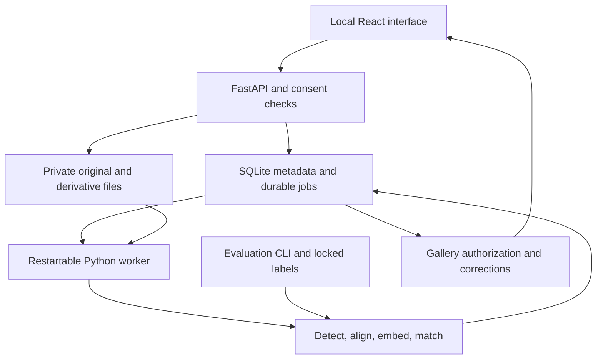

# Face recognition POC architecture and decisions

31 October 2026 · Repository: https://github.com/rakshitachopade2-del/face-recognise

## 1. Recommendation

Build a **local, measurable photo-to-guest retrieval POC** before building the wedding application. Use a Python engine behind a small React interface. Start with conservative direct matching; compare grouping only after the direct baseline works. Use the same engine from the UI and the evaluation command so the demo and the reported results cannot diverge.

The first candidate is **OpenCV YuNet detection + AuraFace recognition through ONNX Runtime**. Compare **YuNet + SFace** as a compact alternative. Keep a separately licensed commercial recognizer and AWS Rekognition as challengers if the free candidates fail. AdaFace remains a permission-gated reference, not the predetermined production choice.

This is an engineering starting point, not a claim that AuraFace is the most accurate or cheapest model. The final winner is the lowest fully loaded cost candidate that meets the held-out accuracy, latency, licensing, and privacy gates. If no candidate passes, the result is a failed or narrowed POC—not an invented production recommendation.

**Readiness:** ready for implementation of the local harness and demo. Production accuracy, wedding throughput, anti-spoof performance, and actual cost are **NOT MEASURED**. Git inspection on this date found an empty repository with no commits on `main`; no application code was available to review. Nothing has been committed or pushed by this planning work.

This package supersedes conflicting face-POC assumptions in the supplied planning files. It does not redesign the rest of the wedding product. The user explicitly allowed architecture changes; the former CPU-only, AdaFace-only, and mandatory-clustering choices are reopened. The supplied `09A-CLAUDE.md` describes a separate mock mobile frontend and is not the implementation guide for this new POC.

## 2. What the feature actually does

The operator imports wedding photographs. A participant supplies an authorized enrollment reference. The engine finds photos containing that participant, keeps uncertain matches out, and updates results when more photos arrive. A group photo may appear in several guests' galleries. This is **many-to-many retrieval**, not a partition in which every photo belongs to exactly one person. Store the original once and create guest-to-photo links; optional per-person exports can copy files on demand.

The first interface has five simple views:

1. **Wedding workspace:** create/select a wedding, import a folder, and see processing progress and failures.
2. **Enroll test participant:** record permission, import one or three independent reference images, and see understandable quality/retry messages.
3. **Guest gallery preview:** matched full photographs, a waiting/no-match state, and a Not me action. No face boxes, scores, or face counts.
4. **Operator diagnostics:** explicitly separate access for inspecting detection boxes, missed detections, candidate scores, and error examples. These are evaluation tools, not guest features.
5. **Experiment report:** compare configurations, automatic versus corrected results, latency, and cost inputs; export a sanitized report.

The local app is an operator-controlled test environment. A dropdown that previews a guest is a simulator, not authentication. It must bind to localhost and must not be exposed as a real guest-sharing service.

## 3. Decisions and corrections

| Area | Decision | Reason |
|---|---|---|
| Success | Optimize precision subject to useful recall; explicitly abstain | A wrong gallery assignment is more harmful than a withheld uncertain photograph |
| Clustering | Optional retrieval/grouping aid; never bulk-release every member from a centroid or cover match | One impure group can amplify errors across dozens of photos |
| Recognition | Swappable, versioned model provider | Quality and commercial rights must be evaluated independently |
| Hardware | Measure local CPU, deployment CPU, then GPU if useful | CPU-only is not a cost proof; utilization and batch throughput decide |
| Search | Exact wedding-scoped matrix operations initially | The reference data fits in memory without a separate vector service |
| Enrollment | Compare one reference against three quality-valid, consistent references; five only as an experiment | Extra nearly identical frames do not establish independent evidence |
| Access | Enrollment, membership, and authorization are separate from face similarity | A face match is not a login or permission grant |
| Confirmation | Correction after authorized access; do not show low-confidence private candidates to a guest | A candidate preview is already a disclosure |
| Rescue | Disabled initially | Relabelling a face in a photo already delivered adds no photo recall and can contaminate identity data |
| Scope | Consented adults in the initial POC; event-isolated identities | Keep the first evidence set understandable and controllable |
| Cost | Preserve the ₹450 all-in marginal face-pipeline ceiling as a gate; track ₹50 recognition compute as a subtarget | Moving liveness outside the number does not make the original budget pass |
| Residency | India deployment remains a product constraint | Do not repeat the documents' unsupported blanket claim that every database must be India-resident solely because of DPDP |

Three inherited claims must not be carried forward as facts:

- “MIT code” does not by itself clear a checkpoint's training-data restrictions. AdaFace's author card directs users to the training-data license. [Source](https://huggingface.co/minchul/cvlface_adaface_ir101_webface4m)
- “50 times fewer comparisons” does not imply 50 times fewer wrong photographs. A wrong cluster decision can affect 50 photographs. The pairwise independence calculation in 03A is intuition, not a measured gallery error rate.
- Historical “measured” performance in 03A has no accompanying run artifacts in the supplied files, and some entries are explicitly estimates. It cannot be reused as this POC's benchmark.

## 4. Model choices and licensing status

| Candidate | Why test it | Evidence and limit | Initial status |
|---|---|---|---|
| YuNet | Lightweight detector with five landmarks | OpenCV licenses the model directory MIT; full upstream provenance remains a separate C1 review | Detector candidate |
| AuraFace v1 recognition file | Publisher explicitly targets commercial use and supplies ONNX weights | Apache-2.0 model card; exact training datasets undisclosed and coverage limitations acknowledged | Primary POC embedding candidate; production C1 unresolved |
| SFace | Compact recognition baseline | OpenCV licenses the directory Apache-2.0; that is not a complete training-data rights audit | Secondary POC candidate |
| AdaFace | Compare the previous hypothesis if permitted | Author's license instruction prevents treating MIT code as blanket checkpoint permission | Disabled until evaluation-use basis recorded |
| Commercial InsightFace package | Potential quality challenger with a contractual license | Free pretrained packages are non-commercial; obtain a grant for exact detector, recognizer, deployment, and use | Optional paid challenger, no purchase assumed |
| AWS Rekognition | Managed commercial comparison and possible operating alternative | API direction, retention, service-improvement settings, and real regional costs matter | Optional, credentials and spend cap required |

Primary sources: [YuNet](https://github.com/opencv/opencv_zoo/blob/main/models/face_detection_yunet/README.md), [AuraFace](https://huggingface.co/fal/AuraFace-v1), [AuraFace provenance discussion](https://huggingface.co/fal/AuraFace-v1/discussions/8), [SFace](https://github.com/opencv/opencv_zoo/blob/main/models/face_recognition_sface/README.md), [InsightFace license](https://github.com/deepinsight/insightface), [commercial offering](https://www.insightface.ai/solutions/face-recognition-licensing).

Do not equate unanswered questions with proof of infringement. Equally, do not mark strict C1 satisfied without evidence. The model registry needs separate `evaluation_use_status` and `production_use_status`, with the exact permission basis. The latter remains blocked where provenance or contract scope is unresolved. Product development evaluation is not automatically academic non-commercial research.

Download only the selected AuraFace recognition artifact from its official pinned fal revision. Do not use a same-named file from another publisher. Do not load its entire bundle: it includes demographic and other auxiliary models. No age, gender, emotion, or ethnicity inference is part of this pipeline.

Every model entry records publisher URL, revision, SHA-256, artifact filename, license evidence, dimension, input shape, channel order, normalization, alignment template, runtime, and permitted uses. Hashes must be computed from the actual chosen bytes; this document deliberately supplies no guessed hash.

## 5. Architecture

| Layer | Local POC | Production direction after evidence |
|---|---|---|
| UI | React, TypeScript, Vite, CSS modules | Reuse API contracts in the eventual mobile/web app |
| API | FastAPI, typed validation, localhost | Small authenticated API service in India |
| Engine | Python modules, OpenCV, ONNX Runtime, NumPy | Same versioned containers on selected CPU/GPU workers |
| Metadata/jobs | SQLite WAL, transactional job leases; one worker first | PostgreSQL, transactional outbox, SQS, independent workers |
| Media | Private local filesystem with generated identifiers | Private S3 in Mumbai initially; media egress/storage priced explicitly |
| Face vectors | Versioned private storage accessed only through the engine | Encrypted database/object storage in India; cache only active weddings |
| Progress | Short polling initially; SSE optional | Polling or SSE; no WebSocket required for one-way processing updates |
| Reporting | Local JSON, Markdown, static charts, private error examples | Aggregate monitoring with sensitive data scrubbed |

The POC should not need Redis, Kubernetes, a vector database, an LLM, model training, or a native mobile build. These add no evidence to the first recognition question. PostgreSQL and SQS are production interfaces to preserve, not dependencies to install before a local result is possible.

Prefer one India region for originals, derived face crops, templates, databases, backups, and processing at first. A globally routed object store is not adopted merely for a zero-egress headline. Reassess storage economics separately after actual bandwidth and retention are known.

### Ingest and detection

- Accept JPEG and PNG first, then HEIC with fixture coverage; RAW input means photographer-exported JPEG, not arbitrary camera RAW decoding.
- Preserve originals. Normalize orientation and color before analysis, map all coordinates back to that oriented image, and enforce file-size/pixel-count limits.
- Hash exact bytes within a wedding for retry deduplication. Optionally hash canonical pixels for metadata-only variants. Perceptual similarity flags near-duplicates; it must not silently discard a distinct burst image or a recompressed image whose crop changed.
- Detect on a measured full-image resolution. Compare a higher-resolution/tiled pass on difficult group shots. Include high-resolution images with **zero** first-pass detections in the second-pass policy; otherwise the detector can hide its own misses.
- Merge tile overlaps consistently and retain one observation per physical face detection. Detection thresholds, tile geometry, and resizing are versioned.
- Treat blur, face size, illumination, and landmark validity as calibrated signals. No age/gender model, universal blur constant, or guaranteed poster detector. Keep unprocessed/low-quality reasons visible in internal reports instead of silently losing them.
- Do not claim a screenshot or wrong-event classifier can reliably infer event membership. In the first POC, flag suspicious content for the operator; the selected wedding and import manifest establish scope.

### Alignment and representation

Each model owns its preprocessing contract. Verify landmark order, 112-pixel crop conventions where applicable, RGB/BGR conversion, embedded versus external normalization, and output normalization against the exact upstream runtime. Do not apply AdaFace normalization to SFace or assume every ArcFace-style graph has identical preprocessing. Invalid/NaN/zero vectors fail explicitly.

Cache by `(wedding_id, canonical_asset, preparation_version, detector_version, alignment_version, embedding_version)`. The preparation version includes decoder, EXIF and color handling. Threshold-only changes reuse embeddings; decoder/detector/alignment/model changes invalidate affected derived results. Different embedding versions are never compared.

Keep float32 as the first reference. Quantization and float16 storage are later experiments requiring decision-parity and accuracy checks. Twenty thousand 512-dimensional float32 vectors occupy about **39 MiB**; sixty thousand occupy about **117 MiB**, excluding metadata and intermediate tensors. These are arithmetic storage sizes, not throughput claims. Block matrix operations so active memory stays bounded across ten weddings.

### Direct matching baseline

1. Validate each enrollment reference and reject inconsistent references that appear to depict different people. Use a single reference and a normalized average of three references as separate calibrated configurations.
2. For each usable gallery face, compare against active enrollments in that wedding only.
3. Require a calibrated acceptance threshold **and** a calibrated separation from the next-best distinct guest. If quality is inadequate or two candidates are too close, abstain. Do not use a margin when there is no second candidate as a substitute for the acceptance threshold.
4. Assign at most one guest identity to a face observation. Several different faces in one image can correctly produce several guest links.
5. Deduplicate outputs to `(wedding_id, guest_id, canonical_photo_id)` and retain the supporting face evidence internally.
6. Check active membership, current consent generation, explicit rejection, and asset authorization transactionally before writing a released link and again before serving media.

There is no universal cosine threshold in this handoff. A threshold learned on another model, dataset, guest count, or runtime is not transferred blindly. Threshold configuration has an explicit `uncalibrated`, `provisional`, or `validated` state. Only operator evaluation can use provisional settings; public auto-release requires the applicable validation gate.

### Grouping challenger

After the baseline, test small conservative groups and multiple pose representatives. Groups provide candidate identities and internal navigation; a cluster-level match does not authorize all members. Members still need the independently calibrated delivery rule. Enforce quality, coherence, and ambiguity constraints, cap representative sets, and quarantine uncertain additions. Do not let a weak accepted face recursively update a guest template.

Avoid single-link connected-component chaining. Do not put whole-wedding hierarchical clustering in the live hot path: at 20,000 faces, a dense pairwise representation is already hundreds of millions of pair entries before overhead. An offline cluster-first experiment is useful, but its runtime and memory must be measured at the actual scale.

Use same-photo distinct-face conflicts as a diagnostic constraint, with explicit exceptions for mirrors, collages, and printed portraits. Group merges/splits are versioned, recomputable, and do not erase negative feedback. If grouping fails to improve recall at the same precision or adds unacceptable operating burden, leave it out of production.

## 6. Enrollment, privacy, and corrections

### Closed POC versus real guest enrollment

Local reference imports are allowed for authorized test participants and must be visibly labelled **test enrollment, no liveness verification**. This proves retrieval, not secure remote enrollment.

Before any real guest gallery is accessible, require authenticated wedding membership plus a server-verified liveness session tied to that account and event. Build the enrollment from the **reference face returned by that liveness session**. Do not pass liveness with person A and then accept an unrelated uploaded selfie of person B. If extra views are used, bind them to the same enrollment session and check consistency.

Do not substitute blink detection or “turn your head” alone for validated presentation-attack detection. Test print, screen, replay, session substitution, and injection attempts, plus genuine-user failure and device accessibility. Liveness does not prove a person's civil identity and does not distinguish identical twins reliably. It also does not identify a printed portrait inside an ordinary wedding photo.

AWS lists liveness in Mumbai and provides a returned reference frame. Its efficacy is probabilistic, and its official FAQ documents an AI-services training opt-out. No participant media is sent before the appropriate service-improvement opt-out and account settings are applied. [FAQ](https://docs.aws.amazon.com/rekognition/latest/dg/face-liveness-faq.html), [liveness overview](https://docs.aws.amazon.com/rekognition/latest/dg/face-liveness.html).

### Core records

| Record | Required scope and behavior |
|---|---|
| Wedding/membership | Every role and permitted asset belongs to a wedding; no global face identity |
| Media asset | Canonical hash, source variants, stage, orientation transform, processing versions |
| Face observation | Asset, detection, quality, embedding version; sensitive even without a name |
| Consent/enrollment | Purpose, active state, expiry, monotonically increasing generation, reference version |
| Match evidence | Face/guest/config versions and reason; separate from a released gallery link |
| Gallery link | Unique wedding/guest/photo, state, generation, evidence; access-controlled |
| Rejection | Durable negative association, survives retries, reindexing and group splits |
| Job/outbox | Idempotency key, attempts, lease expiry, consent generation, status |
| Deletion record | Scope, deadline, completed stores, verification result; no face vector in the audit log |

Not me immediately removes the link and blocks that association from reappearing on retries. It does not automatically change the global threshold or train the model. A suspicious group may be withheld and reevaluated, but one rejected image does not logically prove every other member is wrong.

### Withdrawal and retention

Disable enrollment and delivery immediately on withdrawal; purge enrollment templates and owned derived links within the stated 24-hour objective. Stale jobs carry an old consent generation and cannot commit a new link. Stop pending notifications; notifications contain no private preview image and media access always rechecks authorization. Do not rely on long-lived public/signed URLs for immediate revocation.

Keep the production **12-month per-photo-vector retention** as a maximum from the recorded wedding end, with a review of the lawful basis for processing non-enrolled faces before live deployment. An unnamed vector is not anonymous in the strong privacy sense. Separate opt-in identification from the permission to process everyone visible in a photo. Initial POC participants, including evaluation “strangers,” consent to the experiment even though some are deliberately not enrolled for matching.

Do not automatically regenerate expired/deleted biometric data from retained photographs. An old 07 suggestion to rescan after expiry is superseded: a new authorized processing purpose and retention policy would be needed. Adding late uploads must not silently extend the event end forever.

POC data expires 30 days after its evaluation run unless its permission specifies a shorter period or the owner explicitly extends it. This experimental default does not change the production maximum. Keep originals separate from derived face data. Purge caches and backups through documented expiry or cryptographic-erasure policy and apply tombstones before restored data is usable. The exact backup destruction SLA must be stated; logical access revocation is not proof that every backup byte vanished.

Avoid on-device face templates. Clear app-managed transient data on withdrawal, but never promise to erase downloads/screenshots or to contact a powered-off device within 24 hours. State these limits accurately in the eventual product terms.

## 7. Live processing and production sizing

Process each photo as it arrives. Do not wait for a stage to close. Late enrollment scans existing event vectors; late photos scan active enrollment templates. A durable queue, not an in-process API background task, owns unfinished work. Retry at-least-once delivery with idempotent effects, bounded attempts, leases, and a dead-letter/error state.

Use fair scheduling across weddings and prioritize enrollment lookups and newly uploaded live photos over historical reprocessing. Scale by backlog age, measured service rate, and resource limits. During live windows keep a small measured warm pool if cold starts would violate latency. Spot workers are an optional batch cost optimization with on-demand fallback, not the sole live capacity promise.

| Workload | Required evaluation |
|---|---|
| Reference | 5,000 photos, 20,000 faces, 300 enrolled guests |
| Large | 15,000 photos, about 60,000 faces at the same average, 1,000 guests |
| Peak | Ten concurrent reference weddings; include synchronized upload bursts and enrollments |
| Backlog target | 5,000 photos within 30 minutes of last upload, starting measurement with any already-completed work reported |
| Live target | Upload completion to authorized gallery availability ≤5 minutes p95 |
| Enrollment target | First result <90 seconds only where an eligible processed photo exists; otherwise an honest waiting state |

For reference, finishing an unprocessed 5,000-photo batch in 1,800 seconds requires at least **2.78 photos/second** aggregate before headroom. Ten such batches require **27.78 photos/second**. Neither is a measured capability. Upload bytes, decoding, face count, queueing, and final authorization are included in load tests. Do not label a two-thread laptop timing a cloud instance benchmark.

Model upgrades use a new version namespace and a shadow evaluation. Re-embed only permitted retained gallery images and available consented references. If raw references have been deleted, a new incompatible recognizer requires re-enrollment; vectors cannot be converted back into equivalent original selfies. A managed vendor exit similarly cannot be promised without re-enrollment unless a separately consented reference-retention strategy exists.

## 8. Evidence register against the twelve 10B stages

Every stage result and stage cost below is **NOT MEASURED**. The components are proposed implementation choices. Model licenses are described in section 4; software dependencies and their exact licenses must enter the implementation manifest. Costs will be allocated from instrumented runs, not guessed from a vendor benchmark.

| 10B stage | Proposed component | Evidence to produce | Main unresolved issue |
|---|---|---|---|
| 1 Ingest | Decoder, EXIF normalization, event-scoped hashes, durable jobs | Format, orientation, duplicate and crash tests; decode time | HEIC behavior, recompression and burst variants |
| 2 Detection | Pinned YuNet; selective tiled challenger | Full-frame box recall by size; false detections; runtime | Back-row misses and zero-detection trigger |
| 3 Quality | Model-independent quality signals plus calibrated reject policy | Accuracy versus quality and rejected-face recall | Quality is not reliable printed-face or spoof detection |
| 4 Alignment | Provider-specific five-landmark transform | Reference preprocessing/parity fixtures | Channel order and embedded normalization |
| 5 Representation | AuraFace and SFace; permission-gated challengers | Same-crop and end-to-end PR curves, ms/face, peak memory | Indian-wedding performance and full production C1 |
| 6 Grouping | Optional conservative grouping with member checks | Direct versus grouped comparison, contamination and fragmentation | No bulk-release guarantee from 95% purity |
| 7 Enrollment | Closed operator imports; later verified PAD adapter | Reference-count study, capture burden, attack acceptance and genuine rejection | Secure public enrollment and cost |
| 8 Assignment | Exact event-scoped scores, threshold, ambiguity margin | Unique person-photo accuracy at N=300/1,000 | Rare false matches and related-looking people |
| 9 Corrections | Durable Not me suppression; internal operator review | Retry/re-cluster suppression and manual workload | Human corrections cannot be counted as raw model accuracy |
| 10 Delivery | Per-photo jobs, consent-generation check, authorized media service | Late-photo/enrollment tests and queue-inclusive p95 | Concurrent revocation and peak backlog |
| 11 Deletion | Immediate revocation, purge jobs, expiry and restore tombstones | Database/storage/cache/restore verification report | Offline devices, backups and irretrievable downloads |
| 12 Monitoring | Shared evaluation engine, run manifests, aggregate reports | Sealed report, uncertainty, drift and cost signals | Production complaint rates are not ground-truth accuracy |

The old baseline remains a named comparison configuration: permitted AdaFace + YuNet + offline cluster-first, subject to rights and runtime feasibility. If it cannot legally or technically be run, report **NOT RUN with reason** rather than fabricating a baseline curve. The same applies to all managed or paid challengers.

## 9. How the POC becomes a decision

Read `02-Evaluation-and-Acceptance.md` for labels, experiments, and exact gates; `03-Codex-Build-Prompt.md` for the first coding session; and `04-Cost-and-Provider-Comparison.md` for cost formulas and the managed alternatives.

The first useful dataset is 200–500 permitted photographs of roughly 20–40 consenting adults, with separate enrollment references, unknown identities, and difficult group shots. It is a usability/debug set, not launch evidence. The stronger evaluation uses independent held-out weddings and genuine phones/conditions. Dataset rights, not download availability, determine whether public benchmarks can supplement it.

Choose the architecture in this order:

1. Reject any candidate with impermissible use or unresolved required production rights.
2. Reject candidates failing photo-delivery precision, no observed incorrect disclosures on the defined release set, recall, or access-control gates; report statistical uncertainty.
3. Among passing candidates, compare total per-wedding cost and operating effort at low volume and peak load.
4. Prefer the simpler direct matcher when grouping provides no demonstrated improvement.
5. Compare CPU and GPU under the same model/quality configuration and fully billed duration.
6. Keep an operator-assisted mode only if its manual workload is measured and the product promise is changed explicitly. Never relabel assisted performance as autonomous accuracy.

The immediate next action is to put this package in the repository and give Codex the build prompt. Model/data unavailability should leave clearly blocked experiments while the harness, adapters, local flow, and synthetic correctness tests continue. There is no need to build the wedding platform to answer the core question.
